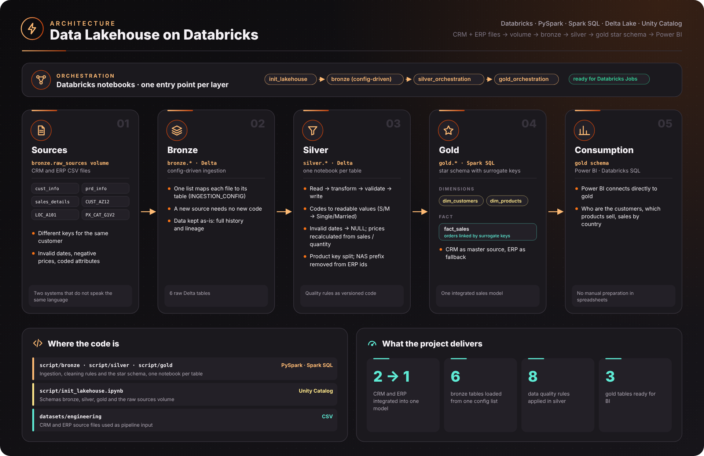
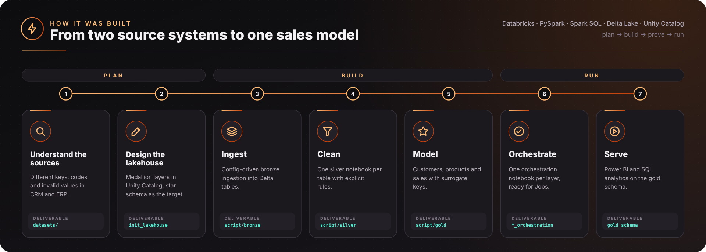
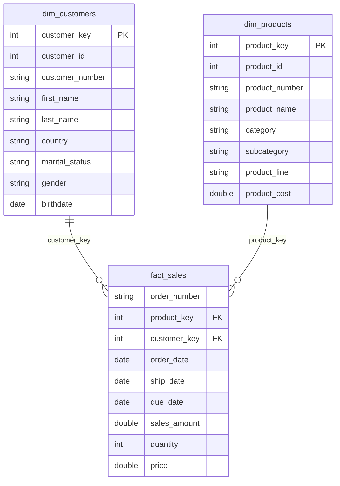

# Data Lakehouse on Databricks — Medallion Architecture

End-to-end **Data Lakehouse** built on **Databricks** with **PySpark**, **Spark SQL** and **Delta Lake**, following the **Medallion Architecture** (Bronze → Silver → Gold). Raw data from two source systems (CRM and ERP) is ingested, cleaned, standardized and modeled into a **star schema** ready for BI tools such as Power BI.

---

## 🎯 Business problem

Sales, customer and product data live in **two systems (CRM and ERP)** that do not speak the same language:

- the same customer has **different keys** in each system (e.g. ERP IDs with a `NAS` prefix);
- attributes are coded differently (`M/F`, `Male/Female`, `S/M`) or missing;
- there are **invalid dates** (zeros, wrong formats, birth dates in the future) and **inconsistent sales values** (missing or negative prices);
- product keys mix category and product codes in a single field.

As a result, the business cannot answer basic questions — *who are our customers, which products sell, how much did we sell by country* — without manual work in spreadsheets, and every report shows slightly different numbers.

## 💡 Solution

A **lakehouse with medallion architecture** on Databricks:

| Layer | What it does | Problem solved |
|---|---|---|
| **Bronze** | Config-driven ingestion of every source file into Delta tables, as-is | Full history and lineage of the raw data; new sources added without new code |
| **Silver** | One notebook per table applying explicit data quality rules (trimming, standardization, invalid date handling, price recalculation, key parsing) | Clean and consistent data, with rules documented and reproducible |
| **Gold** | Star schema (`dim_customers`, `dim_products`, `fact_sales`) integrating CRM and ERP with surrogate keys | A single, analytics-ready sales model for Power BI and SQL |

## 📈 Results

- **One integrated view** of customers, products and sales across CRM and ERP
- **Data quality rules as code** — every correction is versioned and re-applied on each run
- **BI-ready model**: Power BI connects directly to the gold schema, with no manual preparation
- **Orchestrated by layer** (`silver_orchestration`, `gold_orchestration`), ready to be scheduled as Databricks Jobs

---

## 🏗️ Architecture





<sub>Diagrams generated by [`scripts/build_architecture.py`](scripts/build_architecture.py) (SVG and PNG in `docs/images/`).</sub>

| Layer | Purpose | Tables |
|---|---|---|
| **Bronze** | Raw data, ingested as-is from CSV into Delta tables | `crm_cust_info`, `crm_prd_info`, `crm_sales_details`, `erp_cust_az12`, `erp_loc_a101`, `erp_px_cat_g1v2` |
| **Silver** | Cleaned, typed, standardized and renamed to business-friendly names | `crm_customers`, `crm_products`, `crm_sales`, `erp_customers`, `erp_customer_location`, `erp_product_category` |
| **Gold** | Dimensional model (star schema) for analytics | `dim_customers`, `dim_products`, `fact_sales` |

---

## 🔄 Pipeline

### 1. Setup — `script/init_lakehouse.ipynb`
Creates the `bronze`, `silver` and `gold` schemas in Unity Catalog and the `bronze.raw_sources` volume that stores the raw CSV files.

### 2. Bronze — `script/bronze/`
- `bronze_layer_(improved).ipynb`: **config-driven ingestion** — a single list (`INGESTION_CONFIG`) maps each source file to its target table, so adding a new source requires no new code.
- `bronze_layer(basic).ipynb`: first, step-by-step version kept for comparison.

### 3. Silver — `script/silver/`
One notebook per table, all following the same structure (read → transform → validate → write). Main data quality rules:

| Rule | Example |
|---|---|
| Trim all string columns | applied to every table |
| Standardize codes into readable values | `S/M` → `Single/Married`, `F/M` → `Female/Male`, product line `M/R/S/T` → `Mountain/Road/Other Sales/Touring` |
| Remove invalid records | customers without ID are dropped |
| Fix invalid dates | dates equal to `0` or not in `yyyyMMdd` format become `NULL`; birth dates in the future are removed |
| Recalculate inconsistent values | missing or negative prices are derived from `sales / quantity` |
| Handle nulls | missing product cost → `0` |
| Parse keys | product key split into `category_id` and `product_number`; `NAS` prefix removed from ERP customer IDs |
| Business-friendly naming | `cst_firstname` → `first_name`, `sls_ord_num` → `order_number`, etc. |

`silver_orchestration.ipynb` runs all Silver notebooks in sequence as a single entry point for **Databricks Jobs**.

### 4. Gold — `script/gold/`
- `dim_customers`: integrates CRM and ERP customer data (country, birth date and gender, with CRM as master source and ERP as fallback) with a **surrogate key**.
- `dim_products`: products enriched with category, subcategory and maintenance flag, with a surrogate key.
- `fact_sales`: sales transactions linked to the dimensions through the surrogate keys.

`gold_orchestration.ipynb` runs all Gold notebooks in sequence.

---

## 🧩 Data Model (Gold)



---

## ▶️ How to Run

1. Create a workspace on Databricks Free Edition (or any Databricks workspace with Unity Catalog).
2. Import the `script/` folder into your workspace.
3. Run `init_lakehouse.ipynb` to create the schemas and the volume.
4. Upload the files from `datasets/engineering/` to `/Volumes/workspace/bronze/raw_sources/`, keeping the `source_crm` and `source_erp` folders.
5. Run, in order: `bronze_layer_(improved)` → `silver_orchestration` → `gold_orchestration`.
6. Connect Power BI (or the Databricks SQL editor) to the `gold` schema.

---

## 📁 Repository Structure

```
├── datasets/
│   ├── engineering/        # raw CRM and ERP source files (pipeline input)
│   └── analysts/           # ready-to-use datasets for analysis exercises (sales star schema, HR)
└── script/
    ├── init_lakehouse.ipynb
    ├── bronze/
    ├── silver/
    │   ├── crm/
    │   └── erp/
    └── gold/
```

---

## 🛠️ Tech Stack

**Databricks** · **Unity Catalog** · **Delta Lake** · **PySpark** · **Spark SQL** · **Databricks Jobs**

---

## 👤 Author

**Vitor Chavernue** — Senior Data Engineer & Data Analyst
[LinkedIn](https://www.linkedin.com/in/vitorchavernue/) · [GitHub](https://github.com/vitorchavernue)
